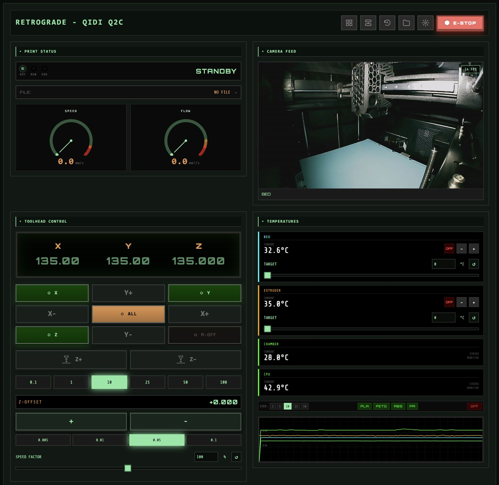
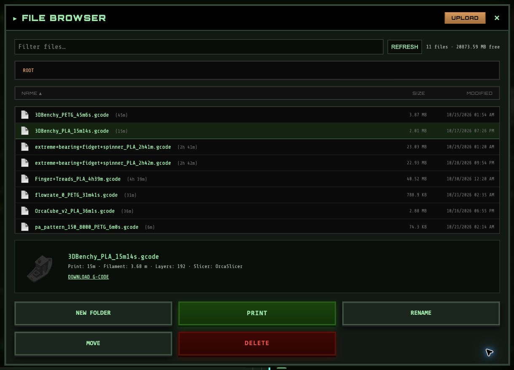

# Retrograde

A retro-styled, reactive web interface for controlling 3D printers running Klipper/Moonraker. Built with Svelte for a snappy, responsive experience with a distinct 1980s terminal aesthetic.




## Features

### 🎮 Real-Time Control
- **Live Position Tracking**: WebSocket connection displays real-time X/Y/Z coordinates
- **Multi-Axis Jogging**: Precise movement control with configurable step sizes (0.1mm - 100mm)
- **Individual & Combined Homing**: Home all axes or individual X, Y, Z axes
- **Motors Control**: Quick motors off (M84) for manual intervention
- **Z-Offset Baby-Stepping**: Real-time Z offset adjustment during printing with configurable increments (0.005mm - 0.1mm)
- **Speed Factor Control**: Adjust print speed in real-time (0-200%)
- **Power Device Control**: Toggle printer power on/off via Moonraker's device_power plugin with visual status indicators

### 🖨️ Print Management
- **Print Status Panel**: Comprehensive print monitoring with color-coded LED indicators (Green/Orange/Red)
- **Retro Dial Gauges**: Animated speed and flow gauges with spring-physics needles and configurable zones
- **Live Metrics**: Real-time display of progress, elapsed time, speed (mm/s), and volumetric flow (mm³/s)
- **Layer Progress**: Track current layer vs. total layers during printing
- **Print Controls**: Pause/Resume/Cancel with configurable macro names and optional confirmation dialogs
- **Clear & Reprint**: Quick buttons to clear completed/cancelled prints or restart the same job
- **File Picker**: Browse Klipper's gcode directory with subdirectory navigation
- **File Uploads**: Drag-and-drop file upload support
- **Send & Print**: Start prints directly from the file browser

### 🔥 Temperature Management
- **Dynamic Sensor Detection**: Automatically discovers all temperature sensors (extruders, bed, MCU, CPU)
- **Multi-Extruder Support**: Detects and controls multiple extruders (T0, T1, T2+)
- **Live Graph**: Real-time temperature visualization with 300-point history
- **Temperature Presets**: Quick presets for PLA, PETG, ABS (customizable)
- **Target Temperature Control**: Adjustable increments (1-50°C steps)

### 🔧 Extruder Control
- **Extrusion Factor**: Adjust flow rate (0-200%)
- **Filament Management**: Configurable load/unload macros with distance and speed parameters
- **Pressure Advance Tuning**: Real-time adjustment in 0.005 increments
- **Smooth Time Tuning**: Fine-tune extruder smooth time

### ⚡ Machine Limits
- **Velocity Control**: Configure max velocity (mm/s)
- **Acceleration Settings**: Adjust max acceleration (mm/s²)
- **Square Corner Velocity**: Fine-tune cornering behavior
- **Cruise Ratio / Max Accel to Decel**: Auto-detects Klipper version for correct parameter

### 📟 Console
- **G-code Console**: Send commands directly to Klipper
- **Command History**: Navigate previous commands with arrow keys
- **Message Ordering**: Configurable newest-first or oldest-first display
- **Response Logging**: Real-time command/response tracking

### 🌡️ Fans & Output Control
- **Dynamic Device Detection**: Auto-discovers all fans and output pins
- **Fan Speed Control**: Slider-based adjustment (0-100%)
- **Output Pin Control**: Toggle and adjust output pins

### 📷 Camera Integration
- **MJPEG Stream Support**: Display live camera feeds from ustreamer/camera-streamer
- **Multiple Cameras**: Configure and switch between multiple cameras with compact buttons
- **Orientation Controls**: Flip horizontal/vertical and rotate (0°, 90°, 180°, 270°)
- **Aspect Ratio Options**: Support for 16:9, 4:3, 1:1, and 21:9 ratios
- **FPS Counter**: Optional live FPS overlay per camera
- **Continuous MJPEG**: A worker parses and decodes a persistent stream; bounded frame queues discard stale frames rather than accumulating latency
- **Configurable Display Rate**: Per-camera rendering limit (new cameras default to 30 FPS; existing limits are preserved)

### ⚙️ Customization
- **Customizable Macro Panels**: Create, edit, delete, and reorder macro panels
- **Unlimited Macros**: Add as many macros as needed with custom labels, G-code, and colors
- **Panel Reordering**: Drag and organize panels to your preference
- **Custom Panel Title**: Rename the interface for your machine
- **Persistent Settings**: Auto-save all settings to localStorage
- **Settings Import/Export**: Backup and restore all settings via JSON file
- **Autoconnect**: Optional automatic connection on page load
- **Version Information**: Build version and commit hash displayed in Settings with GitHub links

### 🔔 Notifications & Safety
- **Error Handling**: Display and track API errors
- **System Status Monitoring**: Detects Klipper shutdown/error states
- **Status LED Integration**: Visual indicators for RUN/ERR states
- **Confirmation Dialogs**: Optional confirmations for Pause, Cancel, and Start Print actions
- **Power Lock Protection**: Respects `locked_while_printing` flag to prevent accidental power-off

### 🎨 Retro Aesthetic
- **CRT Scanline Effect**: Authentic terminal appearance
- **Glowing Green Displays**: Classic monochrome look
- **Tactile Button Feedback**: Shadow-based 3D press effects
- **Orbitron Font**: Retro-futuristic typography
- **Color-Coded Controls**: Orange accents, cyan system controls, red danger buttons

## Installation

### One-Line Install (Recommended)

The classic Klipper ecosystem approach - pipe curl to bash:

```bash
curl -sSL https://justinh-rahb.github.io/moonraker-cnc/install.sh | bash
```

This will:
- Download the latest release
- Install to `~/retrograde`
- Optionally configure nginx to serve the panel

### Manual Installation

1. Download the latest release from the [Releases](https://github.com/justinh-rahb/moonraker-cnc/releases) page
2. Extract the zip to your desired location
3. Serve the files with any web server

Example with Python:
```bash
cd ~/retrograde
python3 -m http.server 8080
```

### Updating

Simply run the installer again - it will backup your existing installation and download the latest version:

```bash
curl -sSL https://justinh-rahb.github.io/moonraker-cnc/install.sh | bash
```

### Uninstalling

```bash
curl -sSL https://justinh-rahb.github.io/moonraker-cnc/install.sh | bash -s -- --uninstall
```

## Development

### Quick Start

```bash
# Install dependencies
npm install

# Start development server
npm run dev

# Build for production
npm run build
```

Open your browser to `http://localhost:5173`

Retrograde was previously named Retro CNC Panel. Existing settings and Moonraker database keys retain their legacy identifiers for compatibility. The installer reuses existing installation directories and accepts older release archive names. Repository and documentation URLs remain unchanged until the repository is renamed.

## Host profiles, shared settings and layouts

Use **HOSTS** to add, select, edit or remove Moonraker connections. Each printer keeps its own macros, cameras, presets, console preferences and dashboard layout. Settings and UX preferences synchronize through that printer's Moonraker database in the application's own `retro_cnc_panel` namespace. Local storage caches settings for offline startup and keeps the browser's connection list. A sync indicator reports unavailable storage or conflicting edits from another browser.

**ARRANGE PANELS** enables drag handles and keyboard-accessible move buttons; **LOCK LAYOUT** hides them. Phone and desktop arrangements are saved separately. **HISTORY** opens recorded Moonraker jobs. File browsing includes filtering, metadata previews, downloads and sequential multiple-file uploads. Slider controls support numeric entry and a reset button. Temperature/fan resets turn the device off; speed/extrusion factors reset to 100%; tuning resets restore Klipper's configured values.

Existing single-printer JSON exports still import. Importing another host adds/selects its profile. **EXPORT CONFIG** exports the active host; **EXPORT ALL HOSTS** backs up the workspace. The old v1 local-storage entry is retained during migration.

### Build defaults and internal themes

Supply a native settings export as first-run defaults:

```sh
DEFAULT_SETTINGS_FILE=./printer-defaults.json APP_THEME=flight npm run build
```

`APP_THEME` accepts `retro` (default) or `flight`, a restrained technical interface using the existing green/orange palette. Theme selection is internal and intentionally has no settings toggle. Defaults only fill missing fields in saved profiles; existing values take precedence. A versioned workspace export can also provide defaults for its active host.

For Docker, put the export in the build context:

```sh
docker build --build-arg DEFAULT_SETTINGS_FILE=printer-defaults.json --build-arg APP_THEME=flight -t retrograde .
docker run --rm -p 1337:80 retrograde
```

Build defaults are embedded in public JavaScript; use UI configuration without credentials. No settings export from a developer's Downloads folder is included in the repository.

For read-only acceptance testing against a real printer:

```sh
VITE_READ_ONLY=true DEFAULT_SETTINGS_FILE=./printer-defaults.json npm run dev
npm test
```

This validation mode blocks hardware, file and database writes from the frontend. Run a normal build for everyday control. Review the [audit and validation record](docs/frontend-audit.md) for remaining Mainsail differences and hardware acceptance limits.

## Initial Setup

1. **First Launch**: Enter your Moonraker IP address (e.g., `192.168.1.100:7125`)
2. **Enable Autoconnect** (optional): Check the box to skip the connection modal on future visits
3. **Customize** (optional):
   - Click the gear icon to open Settings
   - Set your machine name (e.g., "SNAPMAKER U1")
   - Create and customize macro panels for your workflow
   - Configure temperature presets, filament macros, and console settings

## Configuration

### Connection Settings
- **IP Address**: Your printer's Moonraker instance
- **Port**: Default is `7125`
- **Autoconnect**: Automatically connect on page load

### Macro Panels
Create unlimited custom macro panels, each with customizable macros:
- **Panel Management**: Create, delete, and reorder panels
- **Macro Customization**: Label, G-code command, and color for each macro
- **Move Macros**: Reorganize macros between panels

**Default Panels**:
- CALIBRATION: BED_MESH_CALIBRATE, PROBE_CALIBRATE, PID_EXTRUDER, PID_BED
- SYSTEM: FIRMWARE_RESTART, SYSTEM_INFO

### Print Control Macros
Configure custom macro names for print operations:
- **Pause Macro**: Default `PAUSE`
- **Resume Macro**: Default `RESUME`
- **Cancel Macro**: Default `CANCEL_PRINT`

### Filament Macros
Configure load/unload operations:
- **Load Macro**: Default `LOAD_FILAMENT`
- **Unload Macro**: Default `UNLOAD_FILAMENT`
- **Parameters**: Configurable distance and speed parameter names

### Power Device
- **Device Selection**: OFF (hidden), AUTO (recommended), or specific device
- **AUTO Mode**: Automatically selects device named "printer" or first available
- **Confirmation Dialog**: Optional confirmation before toggling power

### Camera Settings
- **Multiple Cameras**: Add, configure, and enable/disable cameras
- **Stream URLs**: Configure MJPEG stream and snapshot URLs per camera
- **Orientation**: Flip and rotation controls per camera
- **Display Rate**: Maximum rendered FPS for worker-backed MJPEG streams; this does not reduce source bandwidth
- **Visibility**: Camera traffic stops when collapsed, offscreen, in a hidden tab, or removed. Streams reconnect when visible again.
- **Compatibility**: Browsers without worker image decoding, or cameras that block cross-origin fetches, use a persistent native MJPEG image; FPS reporting and display limiting are unavailable in that fallback. Relative camera URLs use the same-host app proxy when available.

### Dial Gauge Settings
- **Max Rates**: Configure maximum speed and flow values
- **Redline Thresholds**: Set warning zone thresholds
- **Graphics Mode**: Option to show only numeric values without gauges

All settings persist to browser localStorage automatically.

## Control Layout

### Toolhead Panel
```
┌───────┬───────┬───────┐
│   X   │  Y+   │   Y   │  Individual axis homing
├───────┼───────┼───────┤
│  X-   │  ALL  │  X+   │  Center homes all axes
├───────┼───────┼───────┤
│   Z   │  Y-   │ M-OFF │  Motors off bottom-right
└───────┴───────┴───────┘
```

### Extruder Panel
- Tool selector (T0/T1/T2...) for multi-extruder setups
- Extrusion factor control (0-200%)
- Retract/Extrude with configurable amounts (1-100mm) and speeds
- Load/Unload filament macros
- Pressure advance tuning
- Smooth time adjustment

### Temperature Panel
- Live temperature graph with historical data
- Dynamically displays all detected temperature sensors
- Quick presets for PLA, PETG, ABS
- Target temperature controls with adjustable increments

### Print Status Panel
- Color-coded status LEDs (Green/Orange/Red)
- Animated dial gauges for speed and flow with color zones
- Progress bar with percentage and layer count
- Elapsed time display
- Live speed (mm/s) and volumetric flow (mm³/s)
- Pause/Resume/Cancel controls with optional confirmations
- Clear and Reprint buttons after print completion

### Console Panel
- Direct G-code command input
- Command history navigation (Arrow Up/Down)
- Real-time response logging
- Configurable message ordering

### Machine Limits Panel
- Max velocity and acceleration settings
- Square corner velocity control
- Cruise ratio / max_accel_to_decel (auto-detects Klipper version)

## Tech Stack

- **Framework**: Svelte 5 + Vite
- **Communication**: WebSocket (JSON-RPC 2.0) with Moonraker API
- **Styling**: Vanilla CSS with CSS variables
- **State Management**: Svelte stores
- **Persistence**: localStorage API

## Browser Support

Modern browsers with WebSocket support:
- Chrome/Edge 90+
- Firefox 88+
- Safari 14+

## Development

```bash
# Run dev server with hot reload
npm run dev

# Type checking (if using TypeScript)
npm run check

# Build production bundle
npm run build

# Preview production build
npm run preview
```

## Project Structure

```
src/
├── stores/                    # State management
│   ├── machineStore.js        # Printer state & commands
│   ├── configStore.js         # Settings persistence
│   ├── websocket.js           # WebSocket client
│   ├── notificationStore.js   # Error & notification handling
│   └── consoleStore.js        # Console history & commands
├── lib/
│   └── components/
│       ├── ui/                # Reusable components
│       └── modules/           # Feature panels
├── app.css                    # Global styles
└── App.svelte                 # Main app layout
```

## Contributing

Contributions welcome! This is a personal project but feel free to fork and adapt for your setup.

## License

MIT

## Acknowledgments

- Inspired by classic 1980s CRT terminal interfaces
- Built for Klipper/Moonraker ecosystem
- Fonts: Orbitron, Share Tech Mono (Google Fonts)


Toolhead coordinate readouts accept absolute machine positions: click X/Y/Z, enter a value, and press Enter or the checkmark. Escape or × cancels without moving. The app refreshes homing, job state, travel limits and G-code offsets before dispatch; it restores the prior coordinate/feed modes afterward. Home buttons indicate homing with a checkmark and illuminated border. M-OFF reports actual stepper-enable telemetry through its state icon and tooltip. Z pictograms show increasing/decreasing nozzle–bed separation.
